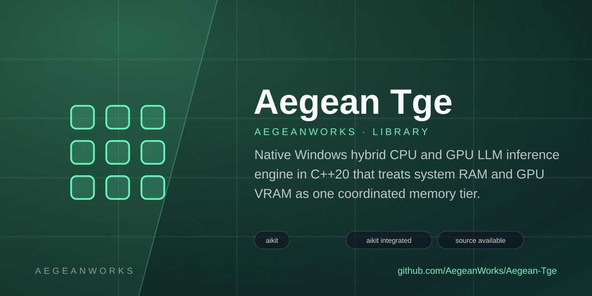

# Aegean TGE

<!-- aegean:media:start -->
<p align="center"></p>
<p align="center"><a href="LICENSE"></a> <a href="https://github.com/AegeanWorks/AIKit"></a></p>
<!-- aegean:media:end -->


Native Windows hybrid CPU and GPU LLM inference engine in C++20 that treats system RAM and GPU VRAM as one coordinated memory tier.

Aegean TGE (Token Generation Engine) is an independent inference runtime. It owns
its model loading, memory placement and kernels; it does not wrap llama.cpp,
Ollama or any other engine.

**Status: 0.1.0 — CPU inference, opt-in Vulkan offload.** Hardware detection,
the AVX2 kernels, the memory budget manager and the Qwen2 decode path are
implemented and tested. GGUF loading, the tokenizer, sampling and text
generation work end to end; the GPU backend is opt-in (`TGE_HAS_VULKAN=1`
with SDK `glslc`, CPU fallback otherwise).

## ⚡ 30-Second Cold-Start Quick Reference

- **Runtime Prerequisites**: Windows 11 x64. Executables are statically linked, so no runtime DLLs or redistributables are needed.
- **Build Prerequisites**: GCC 13+ or MSVC 19.30+, CMake 3.25+, Ninja. `scripts\env.ps1` adds the per-user winget toolchain to `PATH`.
- **Canonical Regression Shield Gate**:
  ```bash
  scripts\test.cmd
  ```
- **Hardware and kernel report**:
  ```bash
  .\build\release\bin\tge.exe info
  ```

```powershell
. .\scripts\env.ps1
cmake --preset release
cmake --build --preset release
.\build\release\bin\tge.exe info
.\build\release\bin\tge.exe gguf <model.gguf>
.\build\release\bin\tge.exe generate --model <model.gguf> --prompt "The capital of France is" --n 32 --text
.\build\release\bin\tge.exe generate --model <model.gguf> --prompt "Once upon a time" --n 128 --speculative --text
.\build\release\bin\tge.exe fidelity --model <model.gguf> --corpus docs\architecture.md
.\build\release\bin\tge.exe bench sessions --model <model.gguf> --sessions 4 --tokens 32 --threads 1
.\build\release\bin\tge.exe bench gemv --rows 4096 --cols 4096 --repeat 5
.\build\release\bin\tge.exe bench gemm --m 1024 --n 1024 --k 1024 --repeat 3
.\build\release\bin\tge.exe bench mem --size-mb 256 --repeat 5
```

**Before touching anything, take a snapshot** (project guideline G-001):

```powershell
.\scripts\measure.ps1 > before.txt
# ... make the change ...
.\scripts\measure.ps1 > after.txt
Compare-Object (Get-Content before.txt) (Get-Content after.txt)
```

`measure.ps1` prints the selected kernels and one line per benchmark, so the
diff shows exactly what moved. It is a single snapshot; this machine varies by
up to 20 percent run to run, so take two or three before believing a small
delta. Every change and its before/after numbers are recorded in
[docs/measurement-log.md](docs/measurement-log.md) (guideline G-002).

`tge info` prints the detected CPU, its instruction sets, the P/E core split, the
cache hierarchy, system memory, and the resulting memory budget.

`tge generate` runs real greedy decoding on a GGUF model and reports prefill and
decode token rates. Token ids are supplied directly, so a tokenizer is not
needed to measure speed; `tge gguf` dumps the metadata and tensors.

`tge bench gemv` measures the decode shape in isolation: one activation vector
through a weight matrix, streamed once. `tge bench gemm` measures prompt
processing. `tge bench mem` measures the raw bandwidth ceiling.

## 📦 What's Inside

```text
aegean-tge/
├── .gitignore                <- build output and models excluded
├── CMakeLists.txt            <- CMake 3.25+, C++20, per-TU ISA flags
├── CMakePresets.json         <- release and debug presets (Ninja)
├── cmake/                    <- bin2h.cmake (SPIR-V embed helper)
├── LICENSE                   <- Aegean License 1.1 (AL-1.1): free personal use
├── COMMERCIAL.md             <- Commercial licensing terms
├── LICENSES/                 <- REUSE license texts
├── REUSE.toml                <- Machine-readable SPDX metadata
├── README.md
├── .aikit/                   <- this project's memory: record, ledger, decisions
├── assets/                   <- generated logo and social preview
├── apps/
│   └── cli/                  <- `tge` executable: info, bench, gguf, plan, generate, fidelity
├── include/
│   └── tge/
│       ├── core/             <- detection, dispatch, thread pool
│       ├── cpu/              <- kernel signatures and dispatch types
│       ├── gpu/              <- Vulkan backend selector (SDK-optional)
│       ├── memory/           <- RAM query, allocator, budget
│       ├── models/           <- GGUF reader and Qwen2 decoder
│       └── tensor/           <- reference operation declarations
├── src/
│   ├── core/                 <- cpu detection, dispatch, thread pool
│   ├── cpu/
│   │   ├── avx2/             <- ISA-specific, compiled with -mavx2 -mfma
│   │   └── scalar/           <- portable fallbacks for every ISA tier
│   ├── gpu/                  <- Vulkan compute backend plus CPU-only noop fallback
│   ├── memory/               <- system RAM, aligned allocation, budget
│   ├── models/               <- GGUF reader and the Qwen2 decoder
│   └── tensor/               <- reference operations
├── tests/                    <- dependency-free harness, run by CTest
├── docs/                     <- architecture, roadmap, hardware, benchmarks, measurement log, ADRs
└── scripts/                  <- env.ps1 (toolchain), test.cmd (gate), measure.ps1 (snapshot)
```

## Verified on this machine

| Measurement | Value |
|---|---|
| CPU | Intel Core i5-14400F, 10C/16T (6P + 4E), AVX2 + FMA + AVX-VNNI |
| Best ISA detected | `avx-vnni` |
| RAM | 16 GiB, single DIMM, 25-29 GB/s threaded read |
| GPU | AMD Radeon RX 9060 XT, 15.67 GiB VRAM (Vulkan only; no HIP SDK) |
| **Decode, Qwen2.5-0.5B Q8_0** | **45 t/s short context; 38-39 t/s at 2048 (llama.cpp build 11624: 45.1 / 46.9 t/s, 6 threads)** |
| **Prompt, 510 tokens** | **166-254 t/s (machine-dependent; llama.cpp: 352.2 t/s, 6 threads)** |
| **Prompt, 2048 tokens** | **170-200 t/s (this run; llama.cpp: 287.9 t/s, 6 threads)** |
| Q4_K_M recipe, same window | prefill 88% and decode 80% of Q8_0; first 15 ids identical across models |
| Concurrent sessions, 0.5B Q8_0 | 2 × 6: 47.4 t/s aggregate; 4 × 6: 53.2 this run, tail forward removed; >1 thread/session safe |
| Speculative decode, story prompt | 49.9-56.4 t/s vs 28.1-30.1 normal (1.66-2.00x); ids identical; pins per-head |
| VNNI prefill, `--vnni` | 510: 194.5 vs 163.1 t/s (+19%); 2048: +14% on the best run; KL 1.6e-3, top-1 485/497; opt-in |
| f16 KV, `--kv f16` | 2048: 165.9 vs 145.7 t/s prefill, 35.4 vs 21.7 decode on the best run; KL 1.658e-6, top-1 497/497, ids identical; opt-in |
| Continuous batching, `bench continuous` | 8 × 32: 69.0 t/s at an 8-token prompt vs 62.3 at 1 and 42.2 sessions; ids identical; 4 slots, mixed prompt+decode |
| GEMV f32 4096² | 18.4 GB/s on 1 thread, 35.4 GB/s on 16 |
| f32 GEMM 1024³ | 66.8 GFLOPS single-thread, 206.6 GFLOPS on 16 threads |
| Quantized formats | Q8_0, Q5_0, Q5_1, Q4_0, Q4_K, Q5_K, Q6_K |
| Context | 4096 by default, `--context` up to 32768 |
| Tests | 123 cases, all passing |

Greedy output matched llama.cpp token for token on the original arithmetic, on
Q8_0 and on Q4_K_M (which mixes four quantized formats in one file). On the
current vectorised/GQA schedules a 128-token raw-prompt run matches for ~95
tokens, then a near-tie flips; `tge fidelity` prices the arithmetic at mean KL
~1e-11 against the full-scalar oracle (scalar attention, norms, RoPE and
SiLU). The older "2x decode" result was against
llama.cpp build a91eab6 (15.2 t/s at 6 threads); the installed build 11624 runs
at 45.1 t/s, so short-context decode is now at parity, and prefill is behind.
Prompts can be given as text (`--prompt`) or token ids (`--tokens`), and output prints as
text with `--text`; the tokenizer was validated against `llama-tokenize` on
punctuation, decimals, contractions and whitespace, including the reference
splitter's optional leading space or punctuation character. Sampling supports
temperature, top-k, top-p, min-p and repetition penalty; top-p and min-p no
longer sort the whole vocabulary, and the benchmarks use greedy so they are
reproducible. CONTROL and USER_DEFINED tokens such as `<|im_start|>` and
`<tool_call>` are matched from prompt text, omitted from text output when they
are structural, and `encode(..., false)` opts out for user content. Generation
stops on the model's end-of-generation set (eos, eot, `eos_token_ids`, and
Qwen's end-of-text id) instead of continuing past it. Decode hands work to a
spin-then-sleep pool; at long context decode attention runs in grouped-query
chunks over positions as well as heads, and the prefill stays per-head.
Prefill is compute-bound so it takes every logical core on an unpinned pool.
Decode workers are likewise unpinned by default (thread placement left to
the OS beat pinned P-cores on mean and variance here); `--pin-threads 1`
restores P-core pinning, and `--threads N` sizes the decode pool —
10 (one per physical core) measured best on a 6P+4E box, 16 oversubscribes
its hyperthreads. `--prefill-threads N` overrides the prefill count
(match `--threads N` for a same-thread comparison against another engine).
`--attention head|gqa|scalar` selects the schedule and `tge fidelity` prices a
change against the scalar oracle. `--speculative` runs prompt-lookup
speculative decoding; it pins the per-head schedule so the verifier and a
sequential decode agree. It engages for greedy decoding (with or without
repeat penalty — penalized positions verify against the penalized argmax
with the same history a sequential decode would see, so ids stay
byte-identical) and for temperature-only sampling (no top-k/p, no min-p;
repeat penalty allowed — each position is accepted against the penalized
distribution, preserving it exactly); other sampling cuts fall back to
single-token decoding. Measured: 1.66-2.00x greedy on a story prompt with
identical ids, 2.03x sampled at temp 0.1 on repetitive text, 1.88x greedy
with penalty; sampling-heavy settings are bounded by the softmax cost
(see the log). `--vnni` selects the AVX-VNNI batch kernels with one activation
quantization per distinct vector; it lifts prefill 14-19 percent on the best
run at the cost of a measured 1.6e-3 KL and 12/497 top-1 flips, so the default
stays f32 (`--vnni` needs AVX-VNNI). `--kv f16` stores the KV cache as IEEE
half (`--kv f16` needs F16C): it halves KV memory and
prices at 1.658e-6 mean KL with 497/497 top-1 and identical free-running ids,
while its speed is not a uniform win; the default stays f32. `bench continuous`
keeps four KV slots active in one model and decodes the active requests in one
weight pass; 8×32 measures 58.3 t/s aggregate against 42.2 for four concurrent
models, with identical ids. Numbers:
[docs/measurement-log.md](docs/measurement-log.md);
method and caveats: [docs/benchmarks.md](docs/benchmarks.md).

## 🛠️ AIKit Commands (run from the AIKit folder)

| Role | Command |
|---|---|
| Status, task and gates | `python aikit.py status aegean-tge` |
| Phase 4: every gate | `python aikit.py check aegean-tge` |
| Repair memory and map, then check | `python aikit.py fix aegean-tge` |
| Resume an interrupted task | `python aikit.py resume aegean-tge` |

<!-- aegean:brand-assets:start -->
## 🎨 Brand Assets

> **AI-Generated Brand Artwork.** The banner and logo are **AI-generated brand assets**. They are illustrative and may not literally depict every feature or the full project scope.
<!-- aegean:brand-assets:end -->

## 📜 License

Free for personal use under the Aegean License 1.1 (AL-1.1); see [LICENSE](LICENSE). Any commercial use needs the Aegean Commercial License 1.0 (ACL-1.0); see [COMMERCIAL.md](COMMERCIAL.md).
